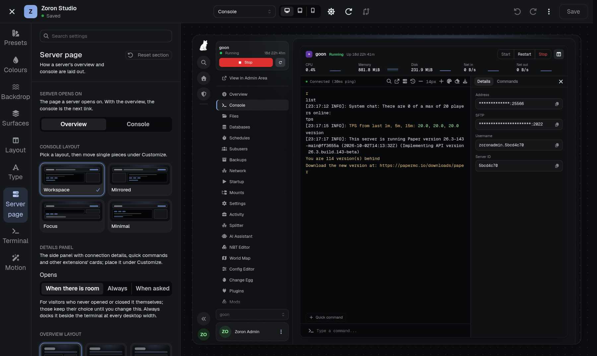
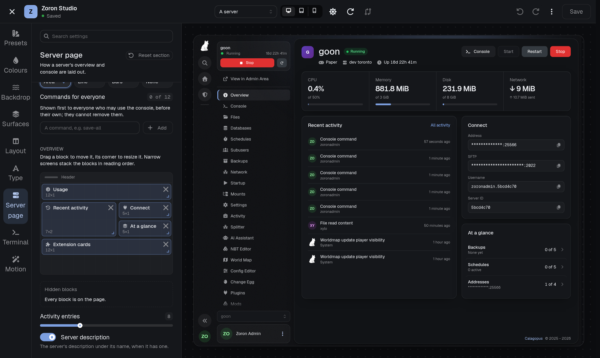
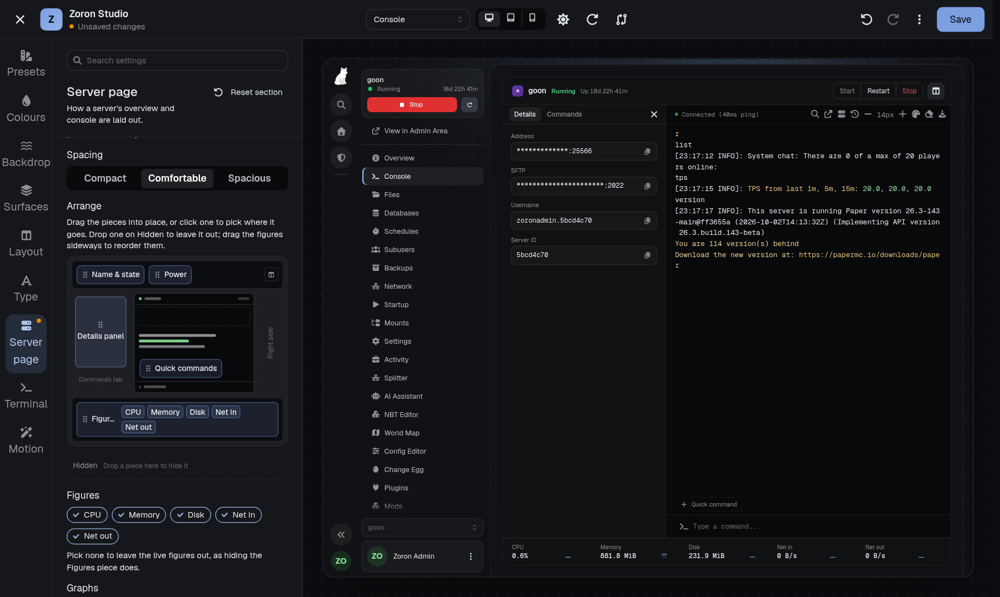

<h1>
  <picture>
    <source media="(prefers-color-scheme: dark)" srcset="docs/logo-dark.svg">
    
  </picture>
</h1>

A theme for [Calagopus Panel](https://calagopus.com): an icon rail with your servers and folders, a full height
console workspace, a server page of its own, and **Zoron Studio**, a live theme editor.

**[Try the demo](https://zoron-demo.caloptreyx.com)** · sign in as `demo` / `zorondemo`

## Features

- **Navigation:** an icon rail with server groups, folders, drag-and-drop organization, server tiles, and responsive mobile navigation.
- **Server views:** searchable and filterable server cards, tiles, or lists; customizable server pages; live resource metrics; and quick access to backups, schedules, and addresses.
- **Console:** a full-height terminal with live stats, quick commands, an inspector, downloadable logs, customizable terminal themes, and multiple frames.
- **Zoron Studio:** live responsive previews, drag-and-drop layouts, theme presets, color and typography controls, import/export, undo/redo, and per-tab settings.
- **Appearance:** nine presets, custom palettes, backdrops, surfaces, light mode, contrast checking, motion controls, and sign-in page links.

Open Studio from **Admin → Zoron Studio** or the extension's card on **Admin → Extensions**. Saving needs
`settings.update` or the extension's own `zoron-theme.update` admin permission.

## Screenshots

| Servers | Server page |
| --- | --- |
|  |  |

| Window frame, Catppuccin | CRT frame, phosphor |
| --- | --- |
|  |  |

| Zoron Studio | Studio's console settings |
| --- | --- |
|  |  |

| Servers page layouts | Arranging the server page |
| --- | --- |
|  |  |

| Arranging the console | Servers as a list |
| --- | --- |
|  |  |

| Server tiles | Sign in page |
| --- | --- |
|  |  |

  
  

## Demo

https://zoron-demo.caloptreyx.com: sign in as `demo` with the password `zorondemo`. It has two Paper servers to try
the rail, folders, server tiles, the console and the server page on, and Zoron Studio to look through. Saving is
turned off there, and the demo resets every hour.

## Install

> [!NOTE]
> Requires Calagopus Panel **1.2.2** or newer.

1. Download `dev_caloptreyx_zoron.c7s.zip` from the [latest release](https://github.com/Caloptreyx/Zoron-Theme/releases/latest).
2. In the panel, open **Admin → Extensions** and install the file.
3. Restart the panel.

The extension is listed as **Zoron Theme** (`dev.caloptreyx.zoron`). To build the zip yourself, run
`python3 scripts/package.py`.

**Admin → Updates** tells you when a newer release is out, with the changes since yours (checked against this
repository's GitHub releases, at most every 10 minutes).

## Support

Need help or want to request a feature? Join the [Caloptreyx Discord](https://discord.gg/4qjMWU7S8x).

## Licence

MIT. The bundled fonts are under the SIL Open Font License, with their licence texts in `frontend/src/fonts`.
